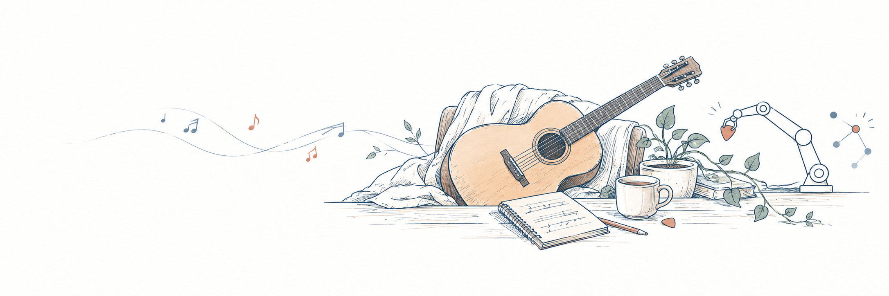

  

<h1 align="center">Hey, I'm Hongtao 👋</h1>

  ECE grad student @ Brown 🐻 · I teach computers to see in 3D 👀 · guitarist on the side 🎸

---

### 🙋 A bit about me

- 📍 Living in Providence, RI, doing my Sc.M. at Brown. I came over from China 🇨🇳 after a CS undergrad
- 🧊 Mostly nerding out about **3D vision**: Gaussian splats, and making 3D humans actually *hold* things without their hands phasing through the cup
- 🎸 15 years of guitar. If the code won't compile, I'm probably playing something
- 🤖 Dream combo: robots 🤝 music (yes, that's what the banner is about)
- 🛠️ I don't only do research, either. I'm happy shipping Flask backends and messy-but-working web apps too

### 🌱 Right now

- 🔧 Contributing to open source: I added **SSL-EY** to the [stable-pretraining](https://github.com/galilai-group/stable-pretraining) library
- 📦 Cleaning up my old research code so it's open-sourced here
- 💬 Open to chatting about research, collabs, or just cool demos!

### 📄 Papers

- **SCGC**: Sparse Control-Guided Gaussian Splatting with Contrastive Learning · *ACM VRCAI 2025* · [paper](https://doi.org/10.1145/3779232.3779453)
- **MambaGuard-MOO**: Multi-Objective Safe Drug Recommendation · *IEEE BigData 2025 Workshop*

### 🧰 Usually found using

### 🔬 Research, in one line each

<b>Click to expand</b> 👇

 

- 🌫️ **SCGC**: sparse control points + contrastive learning to make Gaussian Splatting more consistent across views
- 🤝 **RetHOI**: text-to-3D human–object interaction with diffusion + RetNet; much less foot-skating, faster inference
- 💊 **MambaGuard-MOO**: Mamba-based drug recommendation that balances effectiveness against drug–drug interaction risk

---

  

  
  

